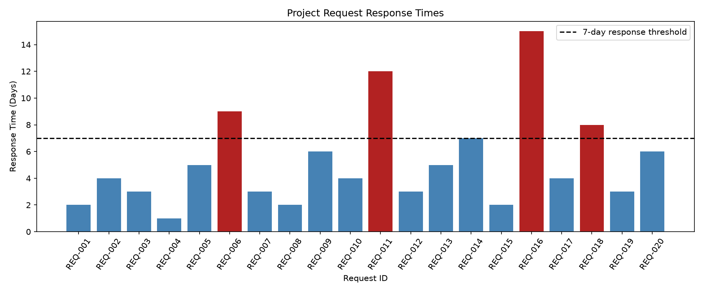

# Project Performance Monitoring — Signal Design and Feature Engineering

**Author:** Brian Cookson

**Date:** November 2026

**Course:** Continuous Intelligence — Northwest Missouri State University

## Overview

This project applies signal design and feature engineering to project performance monitoring. The objective is to transform raw project request response times into meaningful operational indicators using Python and Polars.

The project builds upon Dr. Denise Case's original system monitoring example, adapting its analytical principles to project management and operational performance.

Rather than simply identifying requests that exceed a threshold, this application calculates multiple signals that support comparisons across project phases.

## Data

The project uses a synthetic dataset containing 20 fictional project requests.

Each observation represents one request and includes:

- `request_id` — Unique project request identifier.
- `project_phase` — Planning, Design, or Construction.
- `response_days` — Number of days required to receive a response.

The dataset was created for educational purposes and does not contain actual employer, client, or confidential information.

[View Project Response Dataset](https://github.com/bcookson85/cintel-03-project-signals/blob/main/data/project_responses.csv)

## Techniques Applied

The project demonstrates several analytical and development techniques:

- **Python:** Executes the signal-design pipeline.
- **Polars:** Loads, transforms, and summarizes structured CSV data.
- **Feature Engineering:** Creates new monitoring signals from existing measurements.
- **Binary Indicators:** Identifies requests exceeding a selected threshold.
- **Aggregation:** Calculates average response times and overdue rates by project phase.
- **Matplotlib:** Generates a visual representation of request response times.
- **Structured Logging:** Records pipeline execution and results.
- **Git and GitHub:** Manage source code and document project development.

## Methods and Settings

The application reads project response data from `data/project_responses.csv`.

A seven-day response-time threshold was selected for this instructional analysis.

The detection rule is:

**A request is overdue when `response_days > 7`.**

Requests taking seven days or fewer are considered within the selected threshold.

The seven-day threshold is an illustrative analytical assumption, not an established organizational performance standard.

### Derived Monitoring Signals

The application calculates several features:

**1. Overdue Flag**

A binary indicator representing whether a request exceeds the threshold.

- 1 = Response time exceeds seven days.
- 0 = Response time is seven days or fewer.

**2. Days Over Threshold**

Measures the number of days a request exceeds the selected threshold.

`days_over_threshold = max(response_days - 7, 0)`

**3. Phase Average Response Days**

Calculates the average response time for requests within each project phase.

**4. Overdue Rate Percentage**

Measures the percentage of requests exceeding the threshold within each project phase.

`overdue_rate_pct = (overdue_requests / total_requests) * 100`

These signals transform individual response times into interpretable performance measurements.

## Project Implementation

The custom analysis is implemented in three Python files:

- `src/cintel/utils_project.py` — Loads data and calculates the derived monitoring signals.
- `src/cintel/project_signals.py` — Executes the pipeline and exports results.
- `src/cintel/visualize_project.py` — Generates the response-time visualization.

The original system monitoring example remains available for comparison.

### Run the Custom Signal-Design Pipeline

From the project root directory, execute:

```powershell
uv run python -m cintel.project_signals
```

This command generates:

- `artifacts/project_signals.csv`
- `artifacts/project_phase_summary.csv`

### Generate the Visualization

Execute:

```powershell
uv run python -m cintel.visualize_project
```

The visualization is saved to:

`docs/images/project_response_chart.png`

## Verification

The custom Python pipeline executed successfully using Python 3.14.8 on Windows 11.

Execution confirmed:

- 20 project requests were loaded.
- A seven-day response-time threshold was applied.
- Four requests exceeded the selected threshold.
- The overall overdue rate was 20%.
- Three project phases were summarized.
- Both output CSV files were generated successfully.
- The response-time visualization was generated successfully.

## Results

The application analyzed **20 project requests** and identified **4 overdue requests**, representing **20% of the dataset**.

### Performance by Project Phase

| Project Phase | Total Requests | Average Response Days | Overdue Requests | Overdue Rate |
|---|---:|---:|---:|---:|
| Construction | 6 | 5.17 | 2 | 33.33% |
| Design | 7 | 5.71 | 1 | 14.29% |
| Planning | 7 | 4.71 | 1 | 14.29% |
| **Overall** | **20** | **5.20** | **4** | **20.00%** |

### Requests Exceeding the Threshold

| Request ID | Project Phase | Response Days | Days Above Threshold |
|---|---|---:|---:|
| REQ-006 | Construction | 9 | 2 |
| REQ-011 | Design | 12 | 5 |
| REQ-016 | Planning | 15 | 8 |
| REQ-018 | Construction | 8 | 1 |

The remaining 16 requests did not exceed the selected threshold.

### Results Visualization



*Figure 1. Project request response times compared with the seven-day monitoring threshold. Red bars identify requests exceeding the selected threshold.*

[View Individual Project Signals](https://github.com/bcookson85/cintel-03-project-signals/blob/main/artifacts/project_signals.csv)

[View Project Phase Summary](https://github.com/bcookson85/cintel-03-project-signals/blob/main/artifacts/project_phase_summary.csv)

## Observations

The analysis identified four requests exceeding the seven-day response-time threshold.

Construction recorded the highest overdue rate at 33.33%, with two of six requests exceeding the threshold.

Design had the highest average response time at 5.71 days.

Planning had the lowest average response time at 4.71 days, but also contained the longest individual response time.

REQ-016, a Planning request, required 15 days and exceeded the threshold by eight days.

These observations demonstrate that average response times, overdue rates, and individual exceptions can reveal different aspects of project performance.

## Interpretation and Insights

The results demonstrate how feature engineering can provide a more comprehensive understanding of operational performance than raw response times alone.

For example, Construction had the highest percentage of overdue requests, while Design had the highest average response time. These differences illustrate why monitoring multiple indicators can be more informative than relying on a single measurement.

REQ-016 provides another useful example. Although Planning had the lowest average response time, one Planning request took 15 days.

In an operational environment, these signals could help analysts identify potential bottlenecks, prioritize reviews, and evaluate opportunities for process improvement.

However, exceeding the selected threshold does not necessarily indicate that a request was mishandled. Project complexity, approval requirements, and other operational circumstances could explain longer response times.

## Limitations

Several limitations should be considered:

- The dataset is synthetic and does not represent actual organizational performance.
- The seven-day threshold was selected for demonstration purposes.
- The analysis does not account for differences in project complexity or request priority.
- Response times are evaluated without project-specific context.
- The application uses static data rather than continuously updated information.
- The dataset contains only 20 observations, limiting the conclusions that can be drawn.
- Project phases contain different numbers of observations.

These limitations prevent the results from being interpreted as evidence of actual organizational performance problems.

## Next Steps

Potential improvements include:

1. Evaluate response-time thresholds using historical project performance data.
2. Develop different thresholds for different project phases or request categories.
3. Include request priority and complexity in the analysis.
4. Introduce time-series monitoring to evaluate changes in performance.
5. Explore moving averages and baseline comparisons.
6. Create interactive dashboards for reviewing project performance signals.
7. Automate reporting as new project request data becomes available.

## Conclusion

This project demonstrates how signal design and feature engineering can transform basic project request data into useful operational monitoring indicators.

Using Python and Polars, the application calculated overdue indicators, days exceeding a threshold, phase-specific average response times, and overdue-rate percentages.

The results showed that four of 20 fictional requests exceeded the seven-day threshold, with meaningful differences across Planning, Design, and Construction.

The analysis illustrates how relatively simple derived features can improve data interpretation, support operational monitoring, and provide a foundation for more advanced continuous intelligence applications.

## Documentation Index

- **Home** — This project report
- [Project Instructions](project-instructions.md)
- [Glossary](glossary.md)
- [API](api.md)

## Project Links

- [GitHub Repository](https://github.com/bcookson85/cintel-03-project-signals)
- [Custom Signal-Design Pipeline](https://github.com/bcookson85/cintel-03-project-signals/blob/main/src/cintel/project_signals.py)
- [Project Dataset](https://github.com/bcookson85/cintel-03-project-signals/blob/main/data/project_responses.csv)
- [Results and Artifacts](https://github.com/bcookson85/cintel-03-project-signals/tree/main/artifacts)
- [Original Example Project](https://github.com/denisecase/cintel-03-signal-design)

## Project Resources

- [Project Instructions](project-instructions.md)
- [Professional Python Guide](https://denisecase.github.io/pro-analytics-02/)
- [Professional Python Project Explainer](https://pup-pack.github.io/professional-python-project-explainer/)
